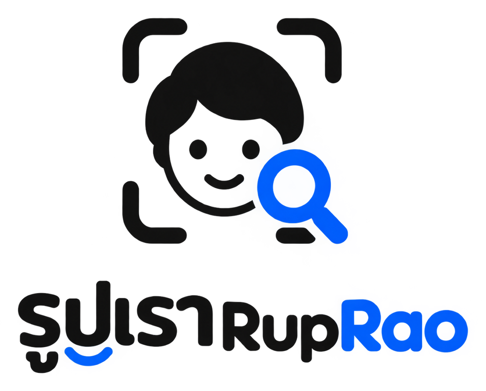

<p align="center">
  
</p>

<h1 align="center">รูปเรา (RupRao) - AI Event Photo Finder</h1>

<p align="center">
  <b>ระบบค้นหารูปภาพในงานอีเวนต์ด้วย AI Face Recognition</b><br>
  ผู้จัดงานอัปโหลดรูปภาพทั้งหมดเข้าสู่ระบบ แชร์ลิงก์หรือ QR Code ให้ผู้ร่วมงาน ถ่ายเซลฟี่เพื่อค้นหารูปของตนเองได้ทันที แม่นยำ รวดเร็ว และคำนึงถึงความเป็นส่วนตัว (PDPA)
</p>

<p align="center">
  
  
  
  
  
  
  
</p>

---

## 📖 สารบัญ (Table of Contents)

- [จุดเด่นและฟีเจอร์หลัก (Key Features)](#-จุดเด่นและฟีเจอร์หลัก-key-features)
- [สถาปัตยกรรมระบบ (System Architecture)](#-สถาปัตยกรรมระบบ-system-architecture)
- [เทคโนโลยีที่ใช้ (Tech Stack)](#-เทคโนโลยีที่ใช้-tech-stack)
- [โครงสร้างโปรเจกต์ (Project Structure)](#-โครงสร้างโปรเจกต์-project-structure)
- [ข้อกำหนดเบื้องต้น (Prerequisites)](#-ข้อกำหนดเบื้องต้น-prerequisites)
- [การติดตั้งและเริ่มต้นใช้งาน (Getting Started)](#-การติดตั้งและเริ่มต้นใช้งาน-getting-started)
- [การทดสอบบนโทรศัพท์มือถือผ่านเครือข่าย Wi-Fi](#-การทดสอบบนโทรศัพท์มือถือผ่านเครือข่าย-wi-fi)
- [การพัฒนาและแก้ไขโค้ด (Development Mode)](#-การพัฒนาและแก้ไขโค้ด-development-mode)
- [คำสั่งสำหรับดูแลระบบ (Operations & Maintenance)](#-คำสั่งสำหรับดูแลระบบ-operations--maintenance)
- [ความปลอดภัยและ PDPA (Privacy & Security)](#-ความปลอดภัยและ-pdpa-privacy--security)
- [ระบบ AI และการปรับจูนความแม่นยำ (AI Calibration)](#-ระบบ-ai-และการปรับจูนความแม่นยำ-ai-calibration)
- [การย้ายขึ้นระบบ Production (Cloudflare R2 / S3)](#-การย้ายขึ้นระบบ-production-cloudflare-r2--s3)
- [ค่าการตั้งค่าสภาพแวดล้อม (Environment Variables)](#-ค่าการตั้งค่าสภาพแวดล้อม-environment-variables)
- [ผู้พัฒนา (Author & Credits)](#-ผู้พัฒนา-author--credits)

---

## ✨ จุดเด่นและฟีเจอร์หลัก (Key Features)

### 📸 สำหรับผู้ร่วมงาน (Attendees)
- **สแกนใบหน้าค้นหารูปในทันที**: ถ่ายเซลฟี่ผ่านกล้องมือถือ/เว็บแคม หรืออัปโหลดรูปใบหน้าเพื่อหารูปที่มีตัวเองในงาน
- **Face Selector (เมื่อในเซลฟี่มีหลายใบหน้า)**: ระบบจะตรวจจับใบหน้าทั้งหมดในรูปถ่าย ให้ผู้ใช้แตะเลือกใบหน้าที่ต้องการค้นหาได้ทันที
- **Responsive Photo Gallery & Lightbox**: ดูรูปภาพความละเอียดสูง พร้อมระบบซูม ข้อมูลรูป และดาวน์โหลดรูปเดี่ยว
- **Multi-select & Batch Download**: เลือกรูปภาพหลายรูปที่ต้องการ แล้วดาวน์โหลดเป็นไฟล์ `.zip` ได้ในคลิกเดียว
- **PDPA & Privacy First**:
  - เซลฟี่ของผู้ใช้ประมวลผลบน RAM ชั่วคราว **ไม่บันทึกลงฐานข้อมูลหรือ Storage**
  - แสดงข้อตกลงและขอความยินยอม (Consent) ก่อนทำการสแกนค้นหา
  - ฟังก์ชัน **"ขอลบรูปภาพ" (Photo Removal Request)** ให้ผู้ร่วมงานส่งคำขอลบรูปของตนเองไปยังผู้จัดงานได้

### 🛠️ สำหรับผู้จัดงาน (Organizers / Admin)
- **ระบบจัดการอีเวนต์ (Event Management)**: สร้างอีเวนต์ได้ไม่จำกัด กำหนดรหัสผ่านเข้าชม (Optional), วันหมดอายุของงาน, และสถานะการเปิด/ปิดอัลบั้มรูปภาพ
- **Batch Photo Uploader**: อัปโหลดรูปภาพงานจำนวนมากพร้อมกันผ่าน Drag & Drop มี Progress bar และระบบตรวจเช็กไฟล์ซ้ำ (SHA-256)
- **Background Processing Queue**: ประมวลผลใบหน้าและแปลงเป็น 512-dim Embedding ในพื้นหลังด้วย Redis Queue (RQ) ไม่ทำให้หน้าเว็บค้าง
- **Auto-Calibration Threshold (วิเคราะห์ความแม่นยำอัตโนมัติ)**: มีปุ่มวิเคราะห์ภาพถ่ายในงานจริงเพื่อคำนวณหาค่า Threshold ความคล้ายคลึงที่ดีที่สุด ลดปัญหาจับคู่ผิดพลาด
- **Scan Optimization for Group Photos**: รองรับการปรับขนาดการตรวจจับใบหน้า (สูงสุด `FACE_DET_SIZE_MAX=1280`) ช่วยให้ตรวจจับใบหน้าขนาดเล็กในรูปหมู่ได้อย่างแม่นยำ พร้อมปุ่ม "สแกนใหม่ทั้งหมด"
- **QR Code & Link Sharing**: สร้างรหัสและ QR Code สำหรับตั้งหน้างานหรือแชร์เข้ากลุ่มได้ทันที

---

## 🏗️ สถาปัตยกรรมระบบ (System Architecture)

ระบบออกแบบตามแนวคิด **Local-first / Docker-first / Production-ready** โดยใช้ **Caddy Reverse Proxy** เป็นทางเข้าเดียว (Single Origin Gateway) เพื่อป้องกันปัญหา CORS และจัดการ HTTPS อัตโนมัติ:

```
                            https://localhost  (Caddy, HTTPS)
                                       │
               ┌───────────────────────┼───────────────────────┐
               ▼                       ▼                       ▼
           / (Root)                 /api/*                 /storage/*
      Next.js (Web UI)          FastAPI (API)             MinIO (S3)
                                       │
                        ┌──────────────┴──────────────┐
                        ▼                             ▼
                 PostgreSQL 16                      Redis 7
              + pgvector (HNSW)             (Job Queue + Rate Limit)
                                                      │
                                                      ▼
                                                Worker (Python)
                                           InsightFace AI + Retention
```

### การแบ่งบทบาทของ Services ใน Docker:
| Service | Image / Base | หน้าที่และความรับผิดชอบ | พอร์ตภายนอก |
| :--- | :--- | :--- | :--- |
| **caddy** | `caddy:2-alpine` | HTTPS / SSL Termination, Reverse Proxy ทางเข้าเดียวเชื่อมทุก Service | `80`, `443`, `3000` |
| **web** | Next.js 16 (Node 20-alpine) | Frontend UI, Camera Capture, Gallery, Admin Dashboard, PWA | ภายใน network |
| **api** | Python 3.11-slim + FastAPI | Auth, Event Management, Search API, Presigned URL, Migrations | `8000` (Localhost) |
| **worker** | Python 3.11-slim + RQ | ตรวจจับใบหน้า (InsightFace), สกัด Feature Vector, ล้างข้อมูลหมดอายุ | ภายใน network |
| **postgres** | `pgvector/pgvector:pg16` | เก็บข้อมูลอีเวนต์ ข้อมูลรูปภาพ และ Face Vectors (ค้นหาด้วย HNSW Index) | `5432` (Localhost) |
| **redis** | `redis:7-alpine` | Message Broker คิวงานสำหรับ Worker และ Rate Limiting | ภายใน network |
| **minio** | `cgr.dev/chainguard/minio` | S3-Compatible Object Storage สำหรับจัดเก็บไฟล์รูปภาพต้นฉบับ | `9000`, `9001` (Localhost) |

---

## 💻 เทคโนโลยีที่ใช้ (Tech Stack)

- **Frontend**: Next.js 16 (App Router), React 19, TypeScript, Tailwind CSS 4, Lucide Icons
- **Backend**: FastAPI, Uvicorn, SQLAlchemy 2 (async-ready), Pydantic v2, RQ (Redis Queue), Pillow, HTTPX
- **AI & Computer Vision**:
  - **InsightFace (buffalo_l)**: ArcFace backbone สำหรับ Face Detection & Recognition
  - **ONNX Runtime**: รันโมเดล AI อย่างมีประสิทธิภาพบน CPU/GPU
  - **OpenCV**: ประมวลผลและปรับขนาดภาพ
- **Database & Search**: PostgreSQL 16 + **pgvector** (Cosine Distance `<=>` ร่วมกับดัชนีแบบ HNSW เพื่อการค้นหาเวกเตอร์ระดับมิลลิวินาที)
- **Object Storage**: MinIO (สำหรับ Local/On-premise) รองรับการสลับไปใช้ Cloudflare R2 หรือ AWS S3 ได้อย่างไร้รอยต่อ
- **Reverse Proxy**: Caddy 2 (รองรับ Automatic HTTPS & Internal CA)

---

## 📁 โครงสร้างโปรเจกต์ (Project Structure)

```text
faceAI/
├── apps/
│   ├── api/                      # Backend API & AI Services (FastAPI)
│   │   ├── app/
│   │   │   ├── api/              # API Routes (auth, admin, public)
│   │   │   ├── db/               # SQLAlchemy models, engine, SQL migrations
│   │   │   ├── schemas/          # Pydantic schemas
│   │   │   ├── services/         # Face AI, Storage, Queue, Calibration, Retention
│   │   │   ├── config.py         # App configuration via pydantic-settings
│   │   │   ├── main.py           # FastAPI app entry point & lifespan
│   │   │   └── worker.py         # RQ background worker process
│   │   ├── tests/                # Pytest unit & integration tests
│   │   ├── Dockerfile
│   │   └── requirements.txt
│   └── web/                      # Frontend Application (Next.js 16)
│       ├── app/                  # App Router pages (/admin, /e/[token], /privacy, etc.)
│       ├── components/           # UI Components (CameraCapture, Gallery, Lightbox, etc.)
│       ├── lib/                  # API client and helper functions
│       ├── public/               # Static assets & brand identity
│       └── Dockerfile
├── data/                         # เก็บไฟล์โมเดล AI (auto-download) [Git Ignored]
├── infra/
│   ├── caddy/                    # Caddyfile reverse proxy config
│   └── postgres/                 # init.sql (เปิดใช้งาน pgvector extension)
├── scripts/                      # สคริปต์ช่วยบริหารจัดการ (Bash)
│   ├── backup.sh                 # สคริปต์ Backup ฐานข้อมูลและ Object Storage
│   ├── restore.sh                # สคริปต์กู้คืนข้อมูล (Disaster Recovery)
│   └── smoke_test.sh             # สคริปต์ทดสอบระบบ End-to-End ผ่าน HTTPS
├── tools/                        # เครื่องมือเสริมสำหรับสื่อประชาสัมพันธ์
│   ├── promo/                    # สร้างวิดีโอโปรโมต (make_promo.py)
│   └── tutorial/                 # สร้างวิดีโอสาธิตการใช้งาน (make_tutorial.py)
├── docker-compose.yml            # Docker Compose หลักสำหรับรันทั้งระบบ
├── docker-compose.dev.yml        # Docker Compose Override สำหรับ Local Hot-Reload
├── .env.example                  # ตัวอย่างไฟล์ตั้งค่า Environment Variables
└── README.md                     # เอกสารประกอบโครงการ
```

---

## 📋 ข้อกำหนดเบื้องต้น (Prerequisites)

1. **Docker Desktop** (บน Windows / macOS) หรือ **Docker Engine + Docker Compose** (บน Linux)
2. RAM ขั้นต่ำ 4 GB (แนะนำ 8 GB ขึ้นไปสำหรับการประมวลผลโมเดล AI)
3. พื้นที่ว่างในดิสก์อย่างน้อย 2–5 GB (สำหรับ Docker Images, ข้อมูลรูปภาพ, และโมเดล AI InsightFace ~300 MB)

---

## 🚀 การติดตั้งและเริ่มต้นใช้งาน (Getting Started)

### 1. คัดลอกไฟล์ Environment Variables
```bash
cp .env.example .env
```
เปิดไฟล์ `.env` แล้วแก้ไขค่าสำคัญต่อไปนี้:
- `ADMIN_PASSWORD`: กำหนดรหัสผ่านสำหรับผู้ดูแลระบบ
- `AUTH_SECRET`: สร้างคีย์สุ่มเพื่อใช้เซ็น JWT/HMAC Session (เช่น ใช้คำสั่ง `openssl rand -hex 32`)

### 2. สั่งรันระบบผ่าน Docker Compose
```bash
docker compose up -d --build
```
> **หมายเหตุในการรันครั้งแรก**:
> ระบบจะดาวน์โหลดโมเดล InsightFace (`buffalo_l` ขนาดประมาณ 300 MB) โดยอัตโนมัติมาเก็บไว้ที่โฟลเดอร์ `data/models/` เพื่อไม่ให้ต้องโหลดซ้ำในครั้งถัดไป

### 3. เข้าใช้งานระบบ
- **หน้าหลักสำหรับผู้ร่วมงาน**: [https://localhost](https://localhost) หรือ [http://localhost:3000](http://localhost:3000)
- **ระบบหลังบ้านผู้จัดงาน (Admin)**: [https://localhost/admin](https://localhost/admin)
- **เอกสารประกอบ API (Swagger Docs)**: [https://localhost/api/docs](https://localhost/api/docs)
- **MinIO Web Console**: [http://localhost:9001](http://localhost:9001) (User: `minio`, Pass: `minio_password`)

> **คำแนะนำเรื่อง HTTPS Certificate**:
> เมื่อเข้าผ่าน `https://localhost` เบราว์เซอร์อาจแจ้งเตือนเนื่องจาก Caddy ใช้ Local Self-Signed CA:
> - สามารถกด "Advanced" แล้วเลือก "Proceed to localhost"
> - หรือใช้ URL [http://localhost:3000](http://localhost:3000) เพื่อทดสอบในเครื่องได้โดยตรง (เบราว์เซอร์อนุญาตให้ใช้กล้องบน `localhost` ได้แม้เป็น HTTP)

---

## 📱 การทดสอบบนโทรศัพท์มือถือผ่านเครือข่าย Wi-Fi

กล้องบนเบราว์เซอร์มือถือ (Safari / Chrome Mobile) บังคับว่าต้องเชื่อมต่อผ่าน **HTTPS** เท่านั้น:

1. ตรวจสอบ IP เครื่องคอมพิวเตอร์ของคุณในวงแลน (เช่น `192.168.1.50`)
2. แก้ไขไฟล์ `.env`:
   ```env
   SITE_ADDRESS=localhost, 192.168.1.50
   ```
3. สั่งรีสตาร์ต Caddy:
   ```bash
   docker compose up -d caddy
   ```
4. เปิดเบราว์เซอร์บนมือถือไปที่ `https://192.168.1.50` และกดยอมรับใบรับรองความปลอดภัย
5. ลิงก์และ QR Code ที่สร้างขึ้นจากหน้าเว็บจะชี้ไปยัง IP วงแลน ทำให้มือถือเครื่องอื่นเปิดสแกนเซลฟี่ได้ทันที

---

## 💻 การพัฒนาและแก้ไขโค้ด (Development Mode)

สำหรับการพัฒนาที่ต้องการ **Hot Reload** (แก้โค้ดแล้วอัปเดตทันทีทั้ง Frontend และ Backend):

```bash
docker compose -f docker-compose.yml -f docker-compose.dev.yml up --build
```

---

## 🛠️ คำสั่งสำหรับดูแลระบบ (Operations & Maintenance)

### ตรวจสอบสถานะและ Logs
```bash
# ดูสถานะ container ทั้งหมด
docker compose ps

# ดู log ของ API และ AI Worker แบบเรียลไทม์
docker compose logs -f api worker
```

### การเพิ่มประสิทธิภาพ (Scale Workers)
หากมีอีเวนต์ขนาดใหญ่และมีรูปภาพที่ต้องสแกนหลายพันรูป สามารถขยาย Worker เพื่อประมวลผลคู่ขนานได้:
```bash
docker compose up -d --scale worker=2
```

### การทดสอบระบบ (Automated Tests)
```bash
# รัน Unit Tests ของ Backend ด้วย pytest
docker compose run --rm --no-deps api pytest -q tests

# รัน Smoke Test ทดสอบการค้นหาใบหน้าแบบ End-to-End
bash scripts/smoke_test.sh path/to/group.jpg path/to/selfie.jpg
```

### การสำรองและกู้คืนข้อมูล (Backup & Disaster Recovery)
```bash
# สำรองข้อมูล PostgreSQL dump + ไฟล์ใน MinIO (เก็บย้อนหลัง 7 วัน)
bash scripts/backup.sh

# กู้คืนข้อมูลจากชุดสำรองที่ต้องการ
bash scripts/restore.sh backups/YYYYMMDD-HHMMSS
```

---

## 🔒 ความปลอดภัยและ PDPA (Privacy & Security)

ระบบถูกออกแบบโดยยึดหลัก **Privacy by Design**:
1. **Zero Selfie Retention**: รูปถ่ายเซลฟี่ของผู้ร่วมงานจะถูกส่งเข้า RAM ของเซิร์ฟเวอร์เพื่อแปลงเป็นเวกเตอร์ 512 มิติ และนำไปเปรียบเทียบในฐานข้อมูล แล้วถูกทิ้งจากหน่วยความจำทันที ไม่มีการบันทึกลงดิสก์
2. **Event Isolation**: ผู้ร่วมงานสามารถค้นหารูปภาพได้เฉพาะภายในอีเวนต์ที่มีโทเคน/รหัสเท่านั้น ไม่สามารถค้นหาข้ามอีเวนต์ได้
3. **Data Retention Policy**: มีระบบตรวจสอบและลบรูปภาพพร้อมเวกเตอร์ใบหน้าอัตโนมัติตามอายุที่กำหนด (ค่าเริ่มต้น 90 วัน)
4. **Photo Removal Rights**: ผู้ร่วมงานมีสิทธิยื่นเรื่องขอลบรูปตนเองได้จากหน้าเว็บ โดยผู้จัดงานสามารถตรวจสอบและกดยืนยันการลบผ่านหน้า Admin
5. **Rate Limiting**: จำกัดจำนวนครั้งในการค้นหา (เช่น 10 ครั้ง/นาที, 200 ครั้ง/วัน ต่อ IP) และป้องกันการ Brute Force รหัสผ่าน Admin

---

## 🧠 ระบบ AI และการปรับจูนความแม่นยำ (AI Calibration)

- **Feature Extraction**: ใช้โครงข่ายประสาทเทียม ArcFace ในการสกัดเอกลักษณ์ใบหน้าออกมาเป็นเวกเตอร์ขนาด 512 มิติ (Normalized Embedding)
- **Vector Search**: ใช้ **pgvector** คำนวณ Cosine Distance โดยมีสูตรความคล้ายคลึง:
  $$\text{Similarity} = 1 - \text{Cosine Distance}$$
- **Threshold Calibration**:
  - สามารถปรับแต่งเกณฑ์ความคล้ายคลึง (Threshold) แยกตามอีเวนต์ได้ (ค่าเริ่มต้น `0.40`)
  - หน้า Admin มีปุ่ม **"วิเคราะห์" (Calibrate)** ซึ่งระบบจะนำใบหน้าภายในงานมาจัดกลุ่มและเปรียบเทียบแบบ Intra-person vs Inter-person เพื่อเสนอแนะค่า Threshold ที่สมดุลที่สุด

---

## ☁️ การย้ายขึ้นระบบ Production (Cloudflare R2 / S3)

สามารถเปลี่ยนจาก Local MinIO ไปใช้ Cloud Storage ชั้นนำได้ง่าย เพียงปรับเปลี่ยนการตั้งค่าใน `.env`:

```env
# ตัวอย่างการเชื่อมต่อ Cloudflare R2
S3_ENDPOINT=https://<account_id>.r2.cloudflarestorage.com
S3_PUBLIC_URL=https://<account_id>.r2.cloudflarestorage.com
S3_ACCESS_KEY=your_r2_access_key
S3_SECRET_KEY=your_r2_secret_key
S3_BUCKET=ruprao-production
S3_REGION=auto
S3_AUTO_CREATE_BUCKET=false

# กำหนดโดเมนจริง (Caddy จะออก SSL Let's Encrypt ให้อัตโนมัติ)
SITE_ADDRESS=ruprao.yourdomain.com
```

---

## ⚙️ ค่าการตั้งค่าสภาพแวดล้อม (Environment Variables)

| ตัวแปร | ค่าเริ่มต้น | คำอธิบาย |
| :--- | :--- | :--- |
| `SITE_ADDRESS` | `localhost` | โดเมนหรือ IP ที่ Caddy ให้บริการ HTTPS (คั่นด้วยจุลภาค) |
| `ADMIN_USERNAME` | `admin` | ชื่อผู้ใช้สำหรับล็อกอินเข้าหน้า Admin |
| `ADMIN_PASSWORD` | - | รหัสผ่านผู้ดูแลระบบ (จำเป็นต้องตั้งค่าใหม่) |
| `AUTH_SECRET` | - | คีย์สุ่มความยาว 32+ ตัวอักษรสำหรับลงนาม Admin Session Token |
| `AUTH_TOKEN_TTL_HOURS` | `12` | อายุของเซสชันผู้ดูแลระบบ (ชั่วโมง) |
| `POSTGRES_DB` | `photo_db` | ชื่อฐานข้อมูล PostgreSQL |
| `POSTGRES_USER` | `photo_user` | ผู้ใช้ฐานข้อมูล PostgreSQL |
| `POSTGRES_PASSWORD` | `photo_password` | รหัสผ่านฐานข้อมูล |
| `S3_ENDPOINT` | `http://minio:9000` | URL Endpoint ของ S3 / MinIO |
| `S3_BUCKET` | `photos` | ชื่อ Bucket สำหรับจัดเก็บรูปภาพ |
| `RETENTION_DAYS_DEFAULT` | `90` | อายุของอีเวนต์ก่อนถูกลบอัตโนมัติตามนโยบาย PDPA (วัน) |
| `SEARCH_DEFAULT_THRESHOLD` | `0.4` | ค่าความคล้ายคลึงขั้นต่ำสำหรับจับคู่ใบหน้า (0.0 - 1.0) |
| `FACE_DET_SIZE_MAX` | `1280` | ขนาดภาพสูงสุดที่ส่งเข้า Face Detector (ยิ่งใหญ่ยิ่งตรวจจับหน้าเล็กได้ดี) |
| `RATE_SEARCH_PER_MINUTE` | `10` | จำกัดจำนวนครั้งในการสแกนค้นหาต่อนาทีต่อ IP |
| `RATE_SEARCH_PER_DAY` | `200` | จำกัดจำนวนครั้งในการสแกนค้นหาต่อวันต่อ IP |

---

## 👤 ผู้พัฒนา (Author & Credits)

- **ผู้พัฒนา**: **Lutfee**
- **สิทธิ์การใช้งาน**: โครงการนี้พัฒนาขึ้นเพื่อการใช้งานค้นหารูปภาพงานอีเวนต์ด้วยเทคโนโลยีปัญญาประดิษฐ์ (AI)
